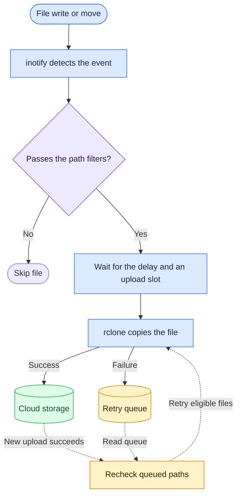

<h1 align="center">📦 rclone-watch</h1>

<p align="center"><strong>Automatically upload files to cloud storage with rclone as they arrive.</strong></p>

<p align="center">
  <a href="#quick-start">Quick start</a> ·
  <a href="#environment-variables">Configuration</a> ·
  <a href="#file-filters">File filters</a> ·
  <a href="#how-it-works">How it works</a> ·
  <a href="README.zh-CN.md">简体中文</a>
</p>

## ✨ Features

- **Recursive watching** captures Linux inotify events when files are closed after writing or moved into the watched directory.
- **Path filtering** selects files by relative path and preserves the directory structure at the destination.
- **Upload controls** include a delay, a concurrency limit, retries, and dry-run mode.
- **Storage backends** include S3, Backblaze B2, and Google Drive through rclone.

## Quick start

### 1. Configure Docker Compose

Save [compose.yaml](compose.yaml) to your deployment directory and create an `.env` file beside it. In this Amazon S3 example, replace the host directory, bucket, and credentials with your own values. Create the host directory before starting the container.

```dotenv
# Docker Compose: select the image version and the host directory to watch.
RCLONE_WATCH_IMAGE=ghcr.io/ldsink/rclone-watch:v0.0.1
WATCH_PATH=/mnt/nas/uploads

# Upload destination: MYREMOTE in the settings below matches myremote in RCLONE_REMOTE.
# S3_PREFIX adds a directory under the bucket before the file's relative path.
RCLONE_REMOTE=myremote:my-bucket/
S3_PREFIX=backup

# Amazon S3 remote: set the backend, AWS region, and credentials for myremote.
RCLONE_CONFIG_MYREMOTE_TYPE=s3
RCLONE_CONFIG_MYREMOTE_PROVIDER=AWS
RCLONE_CONFIG_MYREMOTE_ACCESS_KEY_ID=your-key
RCLONE_CONFIG_MYREMOTE_SECRET_ACCESS_KEY=your-secret
RCLONE_CONFIG_MYREMOTE_REGION=us-east-1

# Upload scheduling: wait after each file event and cap concurrent uploads.
UPLOAD_DELAY=5
MAX_PARALLEL=5

# Set to true to log planned uploads without sending files.
DRY_RUN=false
```

### 2. Start the watcher and follow the logs

```sh
docker compose pull
docker compose up -d
docker compose logs -f
```

Once the watcher is running, write a file to the host directory. For example, `/mnt/nas/uploads/2026/report.txt` uploads to `myremote:my-bucket/backup/2026/report.txt`. Set `DRY_RUN=true` to verify file watching and destination paths. You can omit the remote configuration for this check.

## Environment variables

`RCLONE_WATCH_IMAGE` and `WATCH_PATH` configure Compose. The service loads runtime settings from `.env` and explicitly sets `WATCH_DIR=/watch`, which takes precedence over any `WATCH_DIR` in `.env`. When running the image directly, pass runtime settings with `-e` or `--env-file`.

| Variable                        | Default                                          | Purpose                                                                                                                                         |
| ------------------------------- | ------------------------------------------------ | ----------------------------------------------------------------------------------------------------------------------------------------------- |
| `RCLONE_WATCH_IMAGE`            | Required by Compose                              | GHCR image to deploy, including its tag                                                                                                         |
| `WATCH_PATH`                    | Required by Compose                              | Host directory to watch, mounted read-only in the container                                                                                     |
| `WATCH_DIR`                     | `/watch`                                         | Existing directory to watch inside the container. Override it when running the image directly if the directory is mounted elsewhere             |
| `WATCH_INCLUDE`                 | Empty                                            | Upload only files matching at least one include pattern when configured                                                                         |
| `WATCH_EXCLUDE`                 | Empty                                            | Skip files matching any exclude pattern                                                                                                         |
| `RCLONE_REMOTE`                 | Required for uploads                             | Destination base, such as `myremote:` or `myremote:my-bucket/subfolder/`. Dry runs use `cloud/` if unset or empty                               |
| `RCLONE_CONFIG_<NAME>_TYPE`     | Required for a remote defined in the environment | Remote type, such as `s3`, `b2`, or `drive`                                                                                                     |
| `RCLONE_CONFIG_<NAME>_<OPTION>` | Depends on the backend                           | Backend options, such as S3's `PROVIDER`, `ENV_AUTH`, `ACCESS_KEY_ID`, `SECRET_ACCESS_KEY`, `REGION`, and `ENDPOINT` for S3-compatible services |
| `S3_PREFIX`                     | Empty                                            | Optional relative directory prefix placed before the file path. Applies to any backend                                                          |
| `UPLOAD_DELAY`                  | `5`                                              | Seconds to wait after each file event before scheduling an upload. Use `0` or a positive integer without leading zeros. Empty uses the default  |
| `MAX_PARALLEL`                  | `5`                                              | Maximum concurrent uploads. Use a positive integer without leading zeros. Empty uses the default                                                |
| `DRY_RUN`                       | `false`                                          | Only the literal `true` enables simulation. Logs destination paths and file sizes without invoking rclone                                       |

## File filters

Put one pattern per line in each variable. Empty lines are ignored. Patterns are case-sensitive Bash globs matched against paths relative to `WATCH_DIR`. The `*` wildcard also matches across directory separators, so `*.txt` matches files in subdirectories. When both variables are set, a file must match an include pattern and none of the exclude patterns. The same rules apply to queue retries and `DRY_RUN`.

`v0.0.1` predates file filtering. With an image that supports file filters, add these settings to `.env`.

```dotenv
WATCH_INCLUDE='*.txt
*.csv'
WATCH_EXCLUDE='archive/*
*.tmp.txt'
```

| Relative path        | Result                              |
| -------------------- | ----------------------------------- |
| `2026/report.txt`    | Upload                              |
| `2026/data.csv`      | Upload                              |
| `archive/report.txt` | Excluded by the directory rule      |
| `report.tmp.txt`     | Excluded by the temporary-file rule |
| `photo.jpg`          | Outside the include patterns        |

## Storage destinations

End a destination that includes a path with `/`. The watcher appends the optional `S3_PREFIX` and the relative file path directly to an rclone destination containing a colon. For example, `myremote:my-bucket/subfolder/` with `S3_PREFIX=backup` writes `report.txt` to `myremote:my-bucket/subfolder/backup/report.txt`. A remote root such as `myremote:` already has the required separator.

`<NAME>` is the uppercase remote name before the colon in `RCLONE_REMOTE`. For example, `myremote` uses `RCLONE_CONFIG_MYREMOTE_*`. The bundled rclone also reads its own environment variables, such as `RCLONE_BWLIMIT` for bandwidth limits, `RCLONE_LOG_LEVEL` for logging, and `HTTPS_PROXY` for HTTPS requests. For the full set of options and backend-specific authentication settings, see the [rclone documentation](https://rclone.org/docs/#environment-variables).

- Backblaze B2 uses `TYPE=b2` with backend options such as `ACCOUNT` and `KEY`.
- Google Drive uses `TYPE=drive` with backend options such as `CLIENT_ID`, `CLIENT_SECRET`, and `TOKEN`. Use the same `RCLONE_CONFIG_<NAME>_` prefix for each option.

## How it works



Existing files are skipped at startup, and local files stay in place. The retry queue lives in the container’s `/tmp` and is cleared when the container is recreated.

Network mounts and Docker Desktop host shares may fail to propagate inotify events. Use filenames without newlines.

## Container image

The public image `ghcr.io/ldsink/rclone-watch` supports `linux/amd64`. [See published tags](https://github.com/ldsink/rclone-watch/pkgs/container/rclone-watch).

```sh
docker pull ghcr.io/ldsink/rclone-watch:v0.0.1
```

## License

Released under the [MIT License](LICENSE). The watcher script draws on [dx8ug/rclone-watch](https://github.com/dx8ug/rclone-watch).
