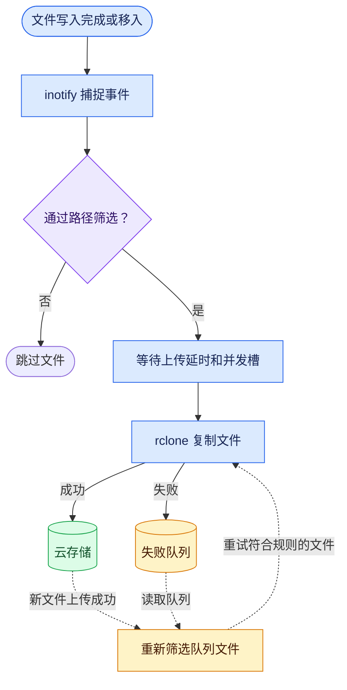

<h1 align="center">📦 rclone-watch</h1>

<p align="center"><strong>文件写入完成后，自动通过 rclone 上传到云存储。</strong></p>

<p align="center">
  <a href="#快速开始">快速开始</a> ·
  <a href="#环境变量">配置</a> ·
  <a href="#文件过滤">文件过滤</a> ·
  <a href="#工作原理">工作原理</a> ·
  <a href="#故障排查">故障排查</a> ·
  <a href="README.md">English</a>
</p>

## ✨ 功能

- **递归监听** — 在 Linux 上通过 inotify 捕捉文件写入完成和移入事件。
- **保留目录结构** — 上传时保留文件相对于监听目录的路径。
- **上传控制** — 支持上传延时、并发上限、失败重试和模拟运行。
- **多种存储后端** — 通过 rclone 上传到 S3、Backblaze B2、Google Drive 等目标。

<a name="快速开始"></a>

## 🚀 快速开始

以下示例使用公开镜像 `ghcr.io/ldsink/rclone-watch:v0.0.3`，需要 `linux/amd64` 宿主机和 Docker Compose。如需限制上传范围，请在启动前配置[文件过滤](#文件过滤)。

### 1. 配置监听目录和 Amazon S3

下载 [compose.yaml](compose.yaml)，在同一目录创建 `.env`。提前创建 `WATCH_PATH` 指向的宿主机目录，并将存储桶、区域和凭据替换为实际值。

```dotenv
RCLONE_WATCH_IMAGE=ghcr.io/ldsink/rclone-watch:v0.0.3
WATCH_PATH=/mnt/nas/uploads

RCLONE_REMOTE=myremote:my-bucket/
RCLONE_CONFIG_MYREMOTE_TYPE=s3
RCLONE_CONFIG_MYREMOTE_PROVIDER=AWS
RCLONE_CONFIG_MYREMOTE_ACCESS_KEY_ID=your-key
RCLONE_CONFIG_MYREMOTE_SECRET_ACCESS_KEY=your-secret
RCLONE_CONFIG_MYREMOTE_REGION=us-east-1
```

### 2. 启动并上传测试文件

在 `compose.yaml` 所在目录运行以下命令。

```sh
docker compose up -d
docker compose logs -f
```

日志出现 `Watches established` 后，在宿主机另开一个终端，向监听目录写入一个新文件。以下命令使用示例中的 `WATCH_PATH`，请按实际路径调整。

```sh
printf '%s\n' 'rclone-watch test' > "/mnt/nas/uploads/rclone-watch-test-$(date +%s).txt"
```

默认等待 5 秒后安排上传。看到 `Uploaded successfully` 后，在存储桶中检查测试文件。子目录结构也会保留，例如 `2026/report.txt` 对应 `myremote:my-bucket/2026/report.txt`。

### 3. 可选：先模拟运行

如果只想验证监听和目标路径，在启动前将 `DRY_RUN=true` 加入 `.env`，然后按上一步写入测试文件。日志应出现 `[DRY-RUN] Will be uploaded`。模拟运行可以省略凭据，省略 `RCLONE_REMOTE` 时会用 `cloud/` 作为日志中的目标前缀。

准备实际上传时，将 `DRY_RUN` 改为 `false`，补齐远端配置，重新运行 `docker compose up -d`，再写入一个新的测试文件。

<a name="环境变量"></a>

## ⚙️ 环境变量

`RCLONE_WATCH_IMAGE` 和 `WATCH_PATH` 用于配置 Compose。服务从 `.env` 加载运行参数，并显式设置 `WATCH_DIR=/watch`，优先于 `.env` 中的同名变量。直接运行镜像时，可以通过 `-e` 或 `--env-file` 传入运行参数。

| 变量                            | 默认值                     | 用途                                                                                                                        |
| ------------------------------- | -------------------------- | --------------------------------------------------------------------------------------------------------------------------- |
| `RCLONE_WATCH_IMAGE`            | 必填（Compose）            | 要运行的镜像及标签，可使用 GHCR 镜像或本地构建的镜像                                                                        |
| `WATCH_PATH`                    | 必填（Compose）            | 宿主机监听目录，以读写方式挂载到容器                                                                                        |
| `WATCH_DIR`                     | `/watch`                   | 容器内已存在的监听目录。直接运行镜像且挂载到其他路径时可覆盖                                                                |
| `WATCH_INCLUDE`                 | 空                         | 设置后，文件需命中至少一条包含规则。参见[文件过滤](#文件过滤)                                                               |
| `WATCH_EXCLUDE`                 | 空                         | 跳过命中任意排除规则的文件。参见[文件过滤](#文件过滤)                                                                       |
| `RCLONE_REMOTE`                 | 上传模式必填               | 目标路径的起点，例如 `myremote:` 或 `myremote:my-bucket/subfolder/`。模拟模式下未设置或为空时使用 `cloud/`                  |
| `RCLONE_CONFIG_<NAME>_TYPE`     | 通过环境变量定义远端时必填 | 远端类型，例如 `s3`、`b2` 或 `drive`                                                                                        |
| `RCLONE_CONFIG_<NAME>_<OPTION>` | 由后端决定                 | 后端配置，例如 S3 的 `PROVIDER`、`ENV_AUTH`、`ACCESS_KEY_ID`、`SECRET_ACCESS_KEY`、`REGION` 和兼容 S3 服务常用的 `ENDPOINT` |
| `S3_PREFIX`                     | 空                         | 可选的相对目录前缀，插在文件相对路径之前，适用于所有后端                                                                    |
| `UPLOAD_DELAY`                  | `5`                        | 每个文件事件在安排上传前等待的秒数。接受 `0` 或无前导零的正整数，留空使用默认值                                             |
| `MAX_PARALLEL`                  | `5`                        | 并发上传任务上限。接受无前导零的正整数，留空使用默认值                                                                      |
| `DRY_RUN`                       | `false`                    | 接受 `true` 或 `false`。设为 `true` 时记录目标路径和文件大小，不调用 rclone。                                               |
| `DELETE_AFTER_UPLOAD`           | `false`                    | 自 `v0.0.3` 起支持。接受 `true` 或 `false`。设为 `true` 时，上传并校验成功后删除未变化的本地文件。                          |

布尔参数未设置或留空时默认为 `false`。其他值只接受 `true` 或 `false`。

<a name="文件过滤"></a>

## 🎯 文件过滤

从 `v0.0.2` 起，可将 `WATCH_INCLUDE` 和 `WATCH_EXCLUDE` 添加到部署用的 `.env`，再运行 `docker compose up -d` 应用规则。

每个变量每行填写一条区分大小写的 Bash 通配规则，匹配相对于 `WATCH_DIR` 的路径。空行忽略，`*` 可以跨目录分隔符。设置 include 后，文件必须命中至少一条 include 规则。命中任意 exclude 规则的文件都会跳过。失败重试和 `DRY_RUN` 也使用相同规则。设置 `DRY_RUN=true` 时，无论 `DELETE_AFTER_UPLOAD` 取何值，监听器都会保留本地文件和失败队列。

```dotenv
WATCH_INCLUDE='*.txt
*.csv'
WATCH_EXCLUDE='archive/*
*.tmp.txt'
```

| 相对路径             | 结果                 |
| -------------------- | -------------------- |
| `2026/report.txt`    | 上传                 |
| `2026/data.csv`      | 上传                 |
| `archive/report.txt` | 命中目录排除规则     |
| `report.tmp.txt`     | 命中临时文件排除规则 |
| `photo.jpg`          | 未命中包含规则       |

<a name="存储目标"></a>

## ☁️ 存储目标

指定目标目录时，路径应以 `/` 结尾。对于含冒号的 rclone 目标，脚本会直接拼接可选的 `S3_PREFIX` 和文件相对路径。例如，目标为 `myremote:my-bucket/subfolder/` 且设置 `S3_PREFIX=backup` 时，`report.txt` 会上传到 `myremote:my-bucket/subfolder/backup/report.txt`。远端根目录（如 `myremote:`）已有分隔符。

`<NAME>` 是 `RCLONE_REMOTE` 冒号前的远端名转为大写，例如 `myremote` 对应 `RCLONE_CONFIG_MYREMOTE_*`。容器内的 rclone 也会读取自己的环境变量，例如限速用的 `RCLONE_BWLIMIT`、控制日志级别的 `RCLONE_LOG_LEVEL`，以及 HTTPS 请求使用的 `HTTPS_PROXY`。完整选项和各后端认证配置请查阅 [rclone 文档](https://rclone.org/docs/#environment-variables)。

<a name="工作原理"></a>

## 🔄 工作原理



启动时跳过已有文件，默认保留本地文件。文件名请避免换行。

<a name="故障排查"></a>

## 🛠️ 故障排查

- **容器启动失败。** 用 `docker compose logs --tail=100 rclone-watch` 查看报错，并检查 `.env` 是否与 `compose.yaml` 同目录、`WATCH_PATH` 指向的宿主机目录是否存在。
- **写入文件后没有日志。** 等待 `Watches established` 后，从宿主机写入一个新文件，并留出 `UPLOAD_DELAY`。如果启用了过滤，检查文件的相对路径是否符合规则。网络挂载或 Docker Desktop 共享目录可能无法传递 inotify 事件，可以换到 Linux 本地目录验证。
- **出现 `Upload failed`。** 查看日志中的 rclone 错误，检查目标路径、凭据和写入权限。用 `docker compose exec rclone-watch cat /tmp/upload_queue.txt` 查看失败队列。修复后写入一个新文件，上传成功后会触发重试。重建容器会清空队列。
- **设置 `DELETE_AFTER_UPLOAD=true` 后源文件仍存在。** 查看日志，确认是否跳过传输、源文件是否变化，或校验、删除是否失败。 如果目标文件已经是最新的，rclone 可能跳过传输，此时会保留本地文件。校验需要读回目标对象，因此远端凭据需要读权限。删除需要源文件所在目录的写权限。请在文件写完后再交给监听器，并避免在上传和校验期间复用同一路径。
- **修改了 `.env`。** 运行 `docker compose up -d` 应用新配置，然后用新文件验证。

<a name="容器镜像"></a>

## 🐳 容器镜像

公开镜像 `ghcr.io/ldsink/rclone-watch` 支持 `linux/amd64`，可直接拉取。[查看已发布标签](https://github.com/ldsink/rclone-watch/pkgs/container/rclone-watch)。

```sh
docker pull ghcr.io/ldsink/rclone-watch:v0.0.3
```

<a name="许可证"></a>

## 📄 许可证

采用 [MIT 许可证](LICENSE)。监听脚本参考了 [dx8ug/rclone-watch](https://github.com/dx8ug/rclone-watch)。
